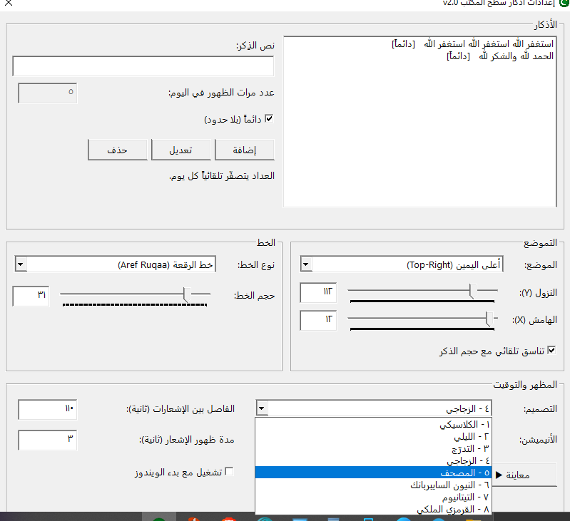
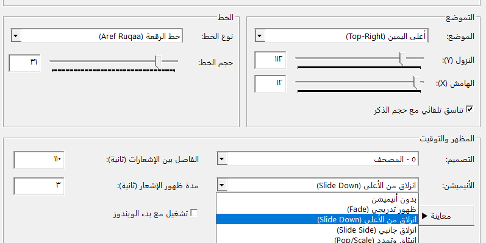
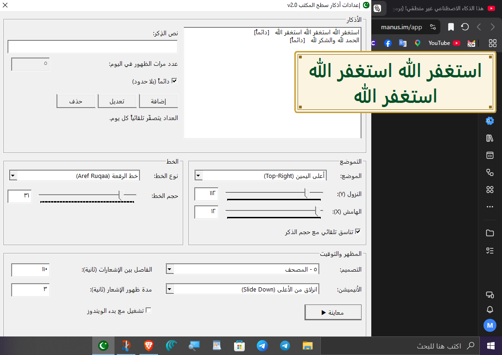
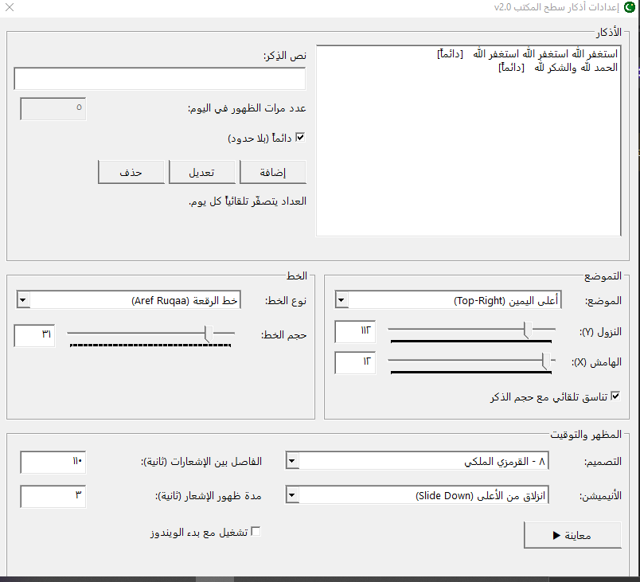
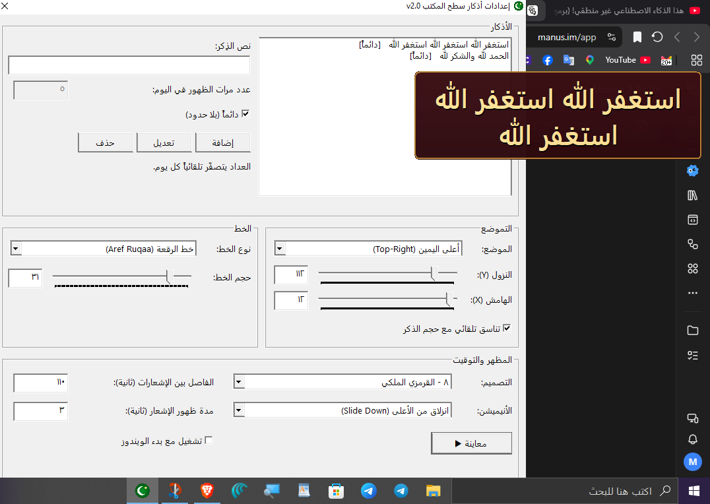

# Azkar Desktop Notifier — إشعارات أذكار سطح المكتب

تطبيق خفيف لنظام Windows يعرض الأذكار دوريًا في إشعارات عائمة، ويمكن التحكم به من أيقونته بجوار الساعة. التطبيق مكتوب بلغة C باستخدام Win32 API وGDI.

## الميزات

- إضافة الأذكار وتعديلها وحذفها، مع حد يومي اختياري وعدّاد يُعاد ضبطه تلقائيًا كل يوم.
- ثمانية تصاميم للإشعارات وخمسة خيارات للحركة.
- اختيار موضع الإشعار وضبط الهوامش والخط والحجم ومدة العرض والفاصل بين الإشعارات.
- خيار التشغيل مع بدء Windows.
- حفظ الإعدادات في `azkar.ini` بجوار البرنامج؛ لا يتضمن هذا المستودع ملف إعدادات المستخدم.

## لقطات شاشة

أُضيفت الصور إلى [`docs/screenshots`](docs/screenshots/):

## الترخيص

هذا المشروع مرخّص بموجب [MIT License](LICENSE).
